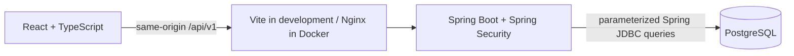

# HealthBridge Insurance Member Portal

A full-stack portfolio application using **synthetic insurance and prescription data only**. Members can review their dashboard, benefits, claims, providers, ID card, profile, and prescriptions. Administrators can view dashboard statistics, search and register members, edit member information, and control login access. The member profile supports contact updates; prescription refill submission is intentionally not implemented.

## Architecture



- Frontend: React 19, React Router, TypeScript, Vite; feature folders under `frontend/src/features`.
- Backend: Java 21, Spring Boot 4.1.2, Spring Security, Spring JDBC, Bean Validation.
- Authentication: server-side HTTP sessions, database-backed ADMIN/MEMBER roles, BCrypt password hashes, session-bound CSRF tokens. No JWTs or browser credential storage.
- PostgreSQL stores member records, accounts, benefits, coverage, claims, providers, and prescriptions.
- `frontend/src/services/api.ts` centralizes requests, CSRF renewal, and session-expiration notifications. `RequireSession` unmounts protected pages on session expiration or logout.
- Existing `data/*.ts` files are synthetic fixtures; member pages read authenticated APIs, including the ID card.

## Repository

| Path | Purpose |
| --- | --- |
| `frontend/src/features` | Feature pages, components, types, and frontend tests |
| `frontend/src/services`, `frontend/src/hooks` | Shared API and loading/error handling |
| `backend/src/main/java/.../security` | Login, logout configuration, sessions, BCrypt, CSRF |
| `backend/src/main/java/.../api` | REST controllers and sanitized error responses |
| `backend/src/main/java/.../service` | Parameterized JDBC queries |
| `backend/src/test` | JUnit, Spring Boot Test, MockMvc regression suite |
| `backend/database` | Synthetic schema/seed scripts; ordered by the bootstrap script |
| `docker/postgres/init.sh` | Fresh-volume initialization and restricted application database role |
| `scripts/smoke_test.py` | Optional real-PostgreSQL, packaged-backend integration check |

## Prerequisites

For development: Java **21+** (compiled for 21), Node **22.22.2+**, **24.15+**, or **26+**, npm, and PostgreSQL **17+**. Maven is supplied through `backend/mvnw`. The optional smoke check also needs Python 3.9+ and the PostgreSQL server tools (`initdb`, `pg_ctl`, `createdb`, `psql`) on `PATH`.

For containers: Docker Engine/Desktop and Docker Compose v2. Docker is not required for frontend tests or MockMvc tests.

## Configuration and secrets

Copy `.env.example` to `.env` and fill in **separate, strong** `POSTGRES_PASSWORD` and `DB_PASSWORD` values. There are no password defaults, preconfigured login passwords, or automatically created login accounts. `.env`, backups, generated files, and logs are ignored by Git and Docker builds. Keep `.env` readable only by its owner.

| Variable | Usage |
| --- | --- |
| `POSTGRES_DB` | Fresh Compose database; defaults to `healthbridge` |
| `POSTGRES_USER`, `POSTGRES_PASSWORD` | Bootstrap administrator; not used by the application |
| `DB_USERNAME`, `DB_PASSWORD` | Restricted application role; must differ from the administrator |
| `DB_URL` | Local backend JDBC URL; default `jdbc:postgresql://localhost:5432/healthbridge`; Compose supplies its own URL |
| `SERVER_PORT` | Local backend port, default `8081` |
| `FRONTEND_PORT` | Compose browser port, default `8088`, bound to localhost |
| `SESSION_TIMEOUT` | Server idle-session timeout, default `30m` |
| `SESSION_COOKIE_SECURE` | `false` for local HTTP; set `true` when served through HTTPS |

Compose reads root `.env` automatically. For a locally launched Java process, export the relevant variables in its environment; Spring does **not** automatically read root `.env`. Never put database credentials in `VITE_*` variables: frontend environment values can become public JavaScript. Do not enable HTTP-body, JDBC-parameter, or Spring Web debug/trace logging on an environment with credentials or member data.

## Docker setup (fresh database)

After configuring `.env`:

```sh
docker compose up --build -d
docker compose ps
```

Open `http://localhost:8088` (or `FRONTEND_PORT`). Only the frontend port is published. PostgreSQL has persistent storage; the backend and database remain on the Compose network. Nginx forwards `/api/` and preserves session cookies on the same browser origin. Direct navigation to React routes works through the SPA fallback.

On a **new, empty** named volume, initialization runs these scripts in order:

1. `healthbridge.sql` — members and claims with synthetic fixtures.
2. `auth_setup.sql` — account schema; no login credentials.
3. `benefits_providers.sql` — benefits, coverage, and providers.
4. `claims_upgrade.sql` — claim details.
5. `feature_upgrade.sql` — profile contact fields and synthetic prescriptions.
6. `portfolio_constraints.sql` — member indexes, case-insensitive account-email uniqueness, nonnegative benefits.
7. `migrations/V001__admin_members.sql` — roles, registration metadata, versions, password setup, restricted MEMBER-assignment function.
8. `migrations/V002__runtime_permissions.sql` — grants to the configured runtime role (after that role is created).

The initializer creates a separate runtime login role with the grants needed by the admin/member APIs. It cannot drop tables, delete members, modify claims/benefit terms, or assign ADMIN. A restricted function can assign MEMBER only. Administrator provisioning needs schema-owner database credentials. Initialization never reruns automatically against an existing volume. This is a bootstrap, **not** an automatic migration system. Review schema changes and back up an existing database before manually applying any upgrade script; some legacy seed scripts overwrite demo rows.

### Create a synthetic member login

Run the explicit interactive provisioner in a terminal:

```sh
docker compose exec backend java \
  -Dloader.main=com.healthbridge.backend.tools.ProvisionDemoAccount \
  -cp /app/app.jar org.springframework.boot.loader.launch.PropertiesLauncher
```

Enter an existing **synthetic** member ID (the seed includes `HB100245`), a demo email, and your chosen password. Password prompts are hidden. The tool requires at least 12 characters and at most 72 UTF-8 bytes, stores only a BCrypt hash, and never prints the password or JDBC errors. It will not overwrite an existing account or reset its password. To exercise multiple members, create additional synthetic member/benefit records deliberately; never use real patient information.

`docker compose stop` stops services while retaining the volume. Do not remove database volumes to apply a schema change.

## Local development

Use an existing, configured development database or create a **new** database for the ordered scripts above. Do not point the bootstrap at an existing database without reviewing it. Export `DB_USERNAME`, `DB_PASSWORD`, and optionally `DB_URL` for the backend.

```sh
# Terminal 1, from backend/
./mvnw spring-boot:run

# Terminal 2, from frontend/
npm ci
npm run dev
```

Visit `http://localhost:5173`. Vite uses port 5173 strictly and forwards `/api` to backend port 8081; it fails clearly if the frontend port is occupied. If the backend port is occupied, stop the old instance or change both `SERVER_PORT` and the Vite proxy target together. Vite preview is for static-build inspection, not the authenticated deployment server; use Nginx/Compose to serve the full packaged app.

For local account provisioning, first run `./mvnw verify` in `backend/`, then run this from the same directory with exported database variables:

```sh
java -Dloader.main=com.healthbridge.backend.tools.ProvisionDemoAccount \
  -cp target/backend-0.0.1-SNAPSHOT.jar \
  org.springframework.boot.loader.launch.PropertiesLauncher
```

## Admin and Member roles

- **ADMIN** opens `/admin`: database-driven counts, recent registrations, member listing/search/filters/pagination, registration, details, permitted edits, and login enable/disable controls. Sensitive updates require confirmation.
- **MEMBER** opens `/dashboard` and retains the existing member portal. Admin pages are absent from navigation, frontend routes redirect away, and admin APIs return 403 to members. Frontend visibility is not the security boundary; Spring Security enforces roles.
- Roles are stored in `roles`/`account_roles`. Registration never accepts or assigns ADMIN. The runtime database role cannot write role tables directly; a constrained function assigns MEMBER. There is no HTTP administrator-registration endpoint.
- The existing account schema references `members`, so local admin provisioning creates an administrative identity record with no benefits. Admin identities are excluded from the member directory/statistics and cannot be changed through member-management APIs.

### Existing database migration

Back up and review an existing database before upgrading. These files add schema and preserve existing members, accounts, claims, benefits, and prescriptions. They were tested on a separate temporary cluster. Inspect your local schema and permissions first: these migrations may already have been applied during local activation.

With `psql` configured for the **intended database as its schema owner**, run each file in a transaction:

```sh
psql -X -v ON_ERROR_STOP=1 --single-transaction -f backend/database/migrations/V001__admin_members.sql
# Export DB_USERNAME as your separate, non-owner runtime role before granting permissions:
psql -X -v ON_ERROR_STOP=1 --single-transaction -f backend/database/migrations/V002__runtime_permissions.sql
```

V002 uses psql's `\getenv` and requires `DB_USERNAME`; it is not a generic JDBC migration script. Existing accounts without roles receive MEMBER; no account is automatically promoted. Historical registration dates remain NULL. Reapplication preserves assigned roles, dates, session versions, and member data. If existing case-insensitive login-email duplicates exist, the migration fails rather than merging or overwriting accounts. Restart the backend after applying the upgrade; old sessions must sign in again.

Fresh Compose databases apply these automatically. Existing Compose volumes do not rerun initialization: apply the reviewed migrations manually, never remove the volume to upgrade.

### Provision an administrator locally

Build the backend with `./mvnw verify`. In a terminal, export `DB_URL`, `DB_USERNAME`, and `DB_PASSWORD` for the **schema-owner database connection** using hidden input/your secret manager. Do not put passwords in command arguments, shell history, or source files. Then, from `backend/`:

```sh
java -Dloader.main=com.healthbridge.backend.tools.ProvisionAdmin \
  -cp target/backend-0.0.1-SNAPSHOT.jar \
  org.springframework.boot.loader.launch.PropertiesLauncher
```

The tool prompts for a synthetic administrator name, email, and a hidden/confirmed password (12+ characters, maximum 72 UTF-8 bytes). It transactionally creates a new identity/account with ADMIN; it does not promote, reset, or overwrite an existing account. Failure rolls back the operation. Restore the regular runtime database environment before starting the application.

For a built/running Docker stack, export the schema-owner `DB_USERNAME`/`DB_PASSWORD` in your shell, then run the same provisioner in a separate interactive container:

```sh
docker compose run --rm --no-deps -e DB_USERNAME -e DB_PASSWORD --entrypoint java backend \
  -Dloader.main=com.healthbridge.backend.tools.ProvisionAdmin \
  -cp /app/app.jar org.springframework.boot.loader.launch.PropertiesLauncher
```

Only variable names travel in these command arguments; values come from your environment. Run from an interactive terminal so hidden password prompts work. Do not configure the regular backend service to run with schema-owner credentials. Sign in using the chosen admin email/password; the app redirects to `/admin`.

### Member registration and password setup

1. An administrator registers full name, email, optional phone/address, plan name/type, and coverage status. Account creation and MEMBER assignment occur in one transaction. Case-insensitive duplicate login emails return 409 without leaving an orphan member.
2. The login starts disabled and requires password setup. The administrator sees a private setup link **once**. Share it through a trusted channel; no email-delivery integration is configured. For a local demo, use a separate private browser window.
3. The random 256-bit token is carried in the URL fragment, never a URL query parameter; only its SHA-256 hash is stored. It expires in 30 minutes. Submission uses POST with CSRF; the address-bar fragment is removed, the password is BCrypt-hashed, and the token is consumed atomically. Setup does not automatically authenticate the browser.
4. The member signs in with their email and chosen password. New accounts have no fabricated benefit amounts: their plan is visible and financial terms are marked awaiting configuration. Changing an existing plan also hides old benefit terms pending review, while retaining all stored records. Benefit-term editing/review is outside this module.
5. Administrators can revoke or replace an outstanding setup link. Replacement invalidates the old link; disabling the account or changing its email also revokes the link. Completed setup cannot be reused as a general password-reset endpoint. An existing account cannot be enabled until setup is complete.

Record versions prevent stale administrator writes (409 prompts a reload). Coverage status and login status are independent. No member deletion endpoint exists. Existing member records without accounts remain visible; the existing local demo-account tool can provision their MEMBER login explicitly.

## API and security behavior

All APIs use `/api/v1`. Member self-service queries use `Authentication.getName()` and a JDBC parameter; administrator queries are separately guarded by ROLE_ADMIN. Caller-provided member IDs do not select another member's data. Providers are shared directory data but require MEMBER. Admin-only identities cannot enter the member self-service APIs. Only `/auth/csrf`, `/auth/login`, and `/auth/password-setup` are public; login and setup still require CSRF on POST.

| Method | Endpoint | Access / behavior |
| --- | --- | --- |
| GET | `/auth/csrf` | Public; creates a session-bound token; returns `{token}` |
| POST | `/auth/login` | Public with valid CSRF; `{email,password}`; rotates session ID and clears anonymous CSRF token |
| GET | `/auth/me` | Authenticated identity and database roles (`{memberId,roles}`) |
| POST | `/auth/logout` | Valid CSRF; invalidates either role's session; returns 204 |
| POST | `/auth/password-setup` | Public with CSRF; `{token,password}`; one-time setup, returns 204 without logging in |
| GET | `/admin/dashboard` | ADMIN; database counts and recent registrations |
| GET | `/admin/members` | ADMIN; `search`, `coverage`, `account`, zero-based `page`, `size` (1–100) |
| GET | `/admin/members/{id}` | ADMIN; safe summary and address, never password hashes |
| POST | `/admin/members` | ADMIN + CSRF; registration; 201 with one-time setup link data |
| PATCH | `/admin/members/{id}` | ADMIN + CSRF; permitted information and current `version` |
| PATCH | `/admin/members/{id}/account` | ADMIN + CSRF; `{enabled,version}` |
| POST | `/admin/members/{id}/password-setup` | ADMIN + CSRF; `{version}`; supersedes an uncompleted setup link |
| GET | `/members/me/benefits` | Current member's coverage and financial totals |
| GET | `/members/me/claims` | Current member's claims |
| GET | `/members/me/profile` | Current member's profile |
| PATCH | `/members/me/profile` | Valid CSRF; updates only `{phone,address}` for the signed-in member |
| GET | `/members/me/prescriptions` | Current member's prescriptions |
| GET | `/providers` | Authenticated provider directory |

For every mutation, fetch `/auth/csrf` and send its token in `X-XSRF-TOKEN`, with the session cookie. Fetch a new token after login/logout. The frontend renews and retries once **only** for a rejected CSRF check; it does not blindly repeat failed writes.

- 400: malformed/invalid input; 401: no valid signed-in session; 403: rejected CSRF or denied access; 404: missing member record; 409: duplicate email or stale/conflicting edit; 503: unavailable database/service.
- Account status, session version, and roles are checked on authenticated requests. Disabled/deleted accounts and changed roles revoke existing sessions. Disable/re-enable cannot revive an old session; changing an account email also revokes sessions and outstanding setup links.
- Session cookies are HttpOnly, SameSite=Lax, cookie-only, and optionally Secure. Authentication and CSRF protections remain enabled.
- Spring Security prevents caching protected responses. Nginx also serves pages with `Cache-Control: no-store`.
- A protected API 401 removes all mounted member pages; returning to the tab also rechecks the session. A normal 403 does not silently sign the member out.
- Error responses omit SQL, connection details, stack traces, and rejected field values. Login DTO string rendering redacts credentials.
- Contact updates are length checked and parameterized. Missing profiles return 404 rather than disclosing a JDBC exception.

## Tests and builds

```sh
# backend/
./mvnw verify

# frontend/
npm ci
npm test
npm run lint
npm run build
# Optional interactive watch mode:
npm run test:watch
```

MockMvc tests run the real application/security chain with a mocked JDBC boundary and require **no database or credentials**. They cover session/CSRF rotation, logout, stale cookies, anonymous rejection, invalid credentials/input, two-member query scoping, profile writes, admin-only reads/writes, registration validation, pagination validation, and error redaction. Mockito uses a startup Java agent configured by Maven, so tests do not depend on runtime self-attachment; the JDBC mock uses subclass mode.

Vitest + React Testing Library run in jsdom and cover login/logout, session expiration, CSRF mutation/renewal behavior, profile editing, accessible coverage filters, role redirects, administrator navigation, member registration/search/account confirmations, password setup, API errors, and aborted/stale requests. These are DOM tests, not full-browser visual tests.

### Optional real database smoke test

After building the backend, from the repository root:

```sh
python3 scripts/smoke_test.py
```

The suite includes a separate one-minute idle-session expiration check and takes at least 63 seconds. This affects only its temporary backend, not the running application.

The check starts a **new temporary PostgreSQL cluster and packaged backend on random loopback ports**. It initializes the same schema and restricted role used by Compose, creates two synthetic accounts with generated passwords, and exercises the actual HTTP/SQL paths, including admin registration and duplicate-email rollback, account controls, repeatable migrations, setup-link expiry/replay/revocation, and concurrent single-use token consumption. It never connects to your existing database. It stops the temporary services afterward and retains its private temporary directory for inspection. This optional check requires local permission to launch processes and bind ports. PostgreSQL's `pgcrypto` extension is used only to seed isolated smoke-test BCrypt hashes; normal runtime/provisioning hashes passwords in Java.

## Deployment preparation

The Dockerfiles build/test in separate stages. The backend runs as a non-root Java 21 user; Nginx also runs unprivileged. Frontend build artifacts contain no database configuration.

Before making a public deployment, supply environment-specific secrets through your host's secret management, terminate HTTPS at a trusted reverse proxy, set `SESSION_COOKIE_SECURE=true`, and deliberately configure public routing. The supplied Compose file binds the frontend to localhost and publishes neither PostgreSQL nor the backend. Do not simply expose the development server. Add platform-level login rate limiting and monitoring appropriate to your hosting environment. No hosting resources are provisioned by this repository.

Sessions are held in the backend process: restarting it signs users out. Multiple backend replicas would require session affinity or a deliberately designed shared-session store. The Compose backend health check verifies its TCP listener; it does not continuously verify database queries. Database health is checked separately. This portfolio app is not a claim of production healthcare compliance.

## Verification record

See [FINAL_E2E_REPORT.md](FINAL_E2E_REPORT.md) for the latest functional verification, with API, React DOM, actual-browser, and manual results clearly separated. `VERIFICATION.md` records the earlier implementation checks, backup location, and changed-file groups. The latest report records exactly which environment was tested and which checks remain manual. No public deployment was performed.

### Password recovery (members and administrators)

The shared sign-in screen includes **Forgot password?**. Recovery uses SendGrid's
[Mail Send API](https://www.twilio.com/docs/sendgrid/api-reference/mail-send/mail-send).
Configure these backend environment variables (locally, in the ignored `backend/.env.local`):

```dotenv
SENDGRID_API_KEY=your-sendgrid-api-key
SENDGRID_FROM_EMAIL=your-verified-sender@example.com
APP_PUBLIC_URL=http://localhost:5173
```

Use a SendGrid key with Mail Send permission and a verified sender. Set
`APP_PUBLIC_URL` to the frontend's HTTPS origin in deployment. Keep the key out of
source control and frontend variables. Rebuild the backend with `./mvnw package`
and restart it with `./start-local.sh` after configuration. Without SendGrid
configuration the recovery form reports that recovery is unavailable.

Enabled accounts with completed password setup can recover either portal's login.
Pending setup accounts must use their administrator-issued setup link; recovery
never enables disabled accounts or changes roles. Links expire in 30 minutes and
work once. Only SHA-256 hashes are stored; reset hashes are separated from setup
hashes. The existing `account_password_setup` table holds the one outstanding link
per account, so no migration or new runtime permissions are needed. A new reset
request replaces the previous link, with a one-minute per-account cooldown.
Successful completion increments the session version, invalidating existing sessions.

Requests receive the same confirmation for known and unknown accounts. SendGrid
work runs in a bounded background queue; failed delivery rolls back the new token
and logs a generic warning without credentials or recipient details. Requests are
limited to five per minute per source IP per backend process (forwarded headers
are not trusted). Use shared edge rate limiting when deploying multiple instances.
Restarting the backend clears queued deliveries and in-memory IP limits. Click
tracking is disabled on recovery emails so private reset links are not rewritten.

### Insurance plan catalog and automatic benefits

Administrators can open **Insurance Plans** to publish an immutable plan version
with medical/pharmacy coverage, exclusions, notes, copays, annual deductible, and
out-of-pocket maximum. Amounts use whole dollars, matching the existing benefit
schema. Effective dates must fall within one calendar benefit year. Use **Create
revised version** to copy a plan into a new version with new effective dates;
existing enrollments do not change. Retiring a version removes it from new
enrollment while preserving assigned coverage.

For an existing database, run the additive, repeatable migration
`backend/database/migrations/V003__insurance_plans.sql` as the schema owner in a
transaction, with `DB_USERNAME` set to the runtime database role. Fresh Compose
volumes apply it automatically. The migration adds a catalog and enrollment
metadata; it does not invent shared plan terms or alter historical member benefits.
The catalog initially has no plans. Publish approved plan terms through the admin
page before creating new members.

`GET /api/v1/admin/insurance-plans` lists all versions. POST to the same endpoint
publishes a version; POST to `/{id}/retire` retires it. The admin-only `/admin/plans`
API now lists only current, non-retired catalog versions. Enrollment submits the
selected `planId`, name, and type, validated together on the server. Legacy API
callers without an ID can enroll only when the name/type resolves to exactly one
currently eligible version. Future and expired versions cannot be assigned.

Enrollment transactionally copies benefit terms and coverage services to the
member's existing benefit tables. New members start with zero deductible and
out-of-pocket spending. Explicit plan reassignment preserves spending within the
same benefit year and resets it when moving to a new known benefit year; unknown
historical years preserve recorded amounts. Saving unrelated member details leaves
the assigned snapshot intact. Existing unconfigured members can receive benefits
by explicitly selecting a published plan in their edit form. Members see the
coverage period and snapshot under **My Benefits** after password setup and login.
Expired assignments display inactive coverage; automatic renewals and future-dated
member enrollment are not implemented. Spending is not automatically advanced by
claims in this feature.

### Admin claims and spending allocations

**Claims Management** in the admin sidebar supports member search, claim creation,
server-side search/status filters and pagination, review, and finalization.
For existing databases apply `backend/database/migrations/V004__admin_claims.sql`
as the schema owner in a transaction, with `DB_USERNAME` set to the runtime role.
Fresh Compose databases apply it automatically. Historical claims are preserved;
the migration does not recalculate or replay spending from those records.

An administrator creates a pending claim against a member's explicitly assigned
plan and a medical/pharmacy service from that member's coverage. The service date
must not be in the future and must fall within the assigned coverage period. A
snapshot records the plan, coverage period, service, exclusions, and benefit
amounts at submission. Historical members without a catalog assignment must first
be assigned a published plan. Enrollment history beyond the currently assigned
snapshot is not reconstructed automatically.

Review is manual: record the allowed amount, insurance payment, member
responsibility, review reason, and how much counts toward the deductible and
out-of-pocket spending. The demo accepts whole-dollar entries. Allowed amount
must equal insurance payment plus member responsibility and cannot exceed billed
amount. Deductible allocation cannot exceed out-of-pocket allocation; both must
fit the member cost and remaining plan limits. Excluded services cannot be
approved. Denied claims have zero insurance payment and spending allocations;
reviewers explicitly record any member responsibility.

Finalizing an approval transactionally updates member spending once. Member,
claim, and benefits locks plus the pending status/version check prevent concurrent
or repeated finalizations from double-counting spending. Plan/year changes while
a claim is pending block approval against the new enrollment. Finalized claims
are read-only in this workflow. Admin identity, review timestamp, notes, and
allocations are recorded. Corrections, reversals, claim appeals, imported prior
coverage histories, and automated insurance payment calculations are not part of
this feature. Historical pending claims without a snapshot require an explicit coverage
confirmation before approval.

Members see the updated status, allowed amount, review notes, and spending
allocations in **My Claims**, and refreshed totals in **My Benefits** after loading
the page. Admin APIs are under `/api/v1/admin/claims`; writes require CSRF and an
ADMIN session. A separate temporary-database smoke test covers registration,
coverage snapshots, payment validation, exclusions, concurrent finalization,
member isolation, and spending updates.

### Workspace presentation and motion

Member promotional banners include decorative floating artwork and a brief content
transition. The existing Pause/Play control also pauses decorative motion; hover
and keyboard focus pause the banner. Reduced-motion preferences disable these
effects and automatic rotation. No pricing or coverage promotions are invented.

Admin forms have personal/coverage sections, visible native validation feedback,
and persistent action bars. Member tables support server-side sorting using the
allowlisted `sort` keys `newest`, `oldest`, `name-asc`, `name-desc`, and `plan-asc`;
sorting resets pagination. Breadcrumbs and a collapsible mobile navigation menu
provide consistent navigation. Loading placeholders and success notices distinguish
loading from completed changes.

### Plan availability and form feedback

Plan cards display Available, Scheduled, Expired, or Retired, with an enrollment
availability explanation. Scheduled plans show their start date; only currently
eligible versions appear in enrollment. Status dates use the application's Central
time calendar, and start/end boundaries are inclusive.

Member, plan, and claims forms use shared field-level validation, focus the first
invalid field, and associate errors with controls for assistive technology. Plan
forms also validate effective periods and financial limits; claim review checks
payment totals and spending allocations before submission. Server validation
remains authoritative, particularly for current remaining spending limits.

Dirty member and plan forms warn before following navigation links, signing out,
or reloading/closing the page. Plan draft cancellation and replacement also require
confirmation when populated. Browser Back navigation is not blocked by this
link-based guard; full history navigation protection requires a router-level blocker.
Unsaved form contents are not stored in browser storage.


### Historical claim coverage confirmation

Apply `backend/database/migrations/V005__claim_coverage_review.sql` as the schema
owner with `DB_USERNAME` set to the runtime role when upgrading an existing
database. Fresh Compose databases apply it automatically. This only grants the
specific columns needed by the coverage confirmation action; it does not change
any existing claim or spending amount.

Historical pending claims expose **Confirm claim coverage**. An administrator must
select a service from the member's explicitly assigned plan and attest that it
applies to the claim. The server verifies the coverage period includes the service
date, locks the member and claim, and records the confirming admin and timestamp
inside the snapshot. Missing assignments, dates outside the plan period, false
attestations, stale versions, finalized claims, and replacement of an existing
snapshot are rejected. No approval or spending update occurs at this step.
The endpoint is `POST /api/v1/admin/claims/{id}/coverage` and requires ADMIN + CSRF.

Payment fields remain editable when Approved is selected, including while legacy
coverage is being reviewed. Coverage confirmation preserves entered amounts.
Approval finalization remains blocked until coverage is confirmed. Denied claims
continue to show zero, disabled insurance/deductible/out-of-pocket allocations.
No historical coverage terms or claim decisions are inferred automatically.
